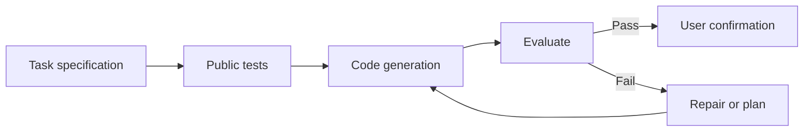

# Importable AdaAssist examples

These seven examples are adapted from the task descriptions supplied with the BigCodeBench demonstration materials. They are intended for hands-on exploration, **not** as exact reproductions of the benchmark evaluation or its original public/hidden tests. The provided tests are intentionally short and may not cover every edge case. The task files contain specifications and placeholders, not reference implementations.

## Import into the extension

1. Open this repository root as your VS Code workspace.
2. Open AdaAssist and configure a Python interpreter and model.
3. Click **Import example from workspace** beneath the task input.
4. Select any folder named `BigCodeBench_<id>` under `examples/`.
5. Review the imported task and public tests, select **Auto** or **Interactive**, then send.

The importer recognizes `task.py` and `public_tests.py` in the same folder and searches up to two levels below the workspace root. Keep the current structure intact.

| Example | Task | Additional Python packages |
| --- | --- | --- |
| [1034](BigCodeBench_1034/) | Sales comparison | pandas, numpy, matplotlib |
| [1086](BigCodeBench_1086/) | Random formatted DataFrame | pandas, numpy, matplotlib |
| [175](BigCodeBench_175/) | Video like-ratio plot | pandas, matplotlib |
| [292](BigCodeBench_292/) | Groupwise feature scaling | pandas, numpy, scikit-learn |
| [327](BigCodeBench_327/) | CSV regex frequency counting | Standard library |
| [493](BigCodeBench_493/) | Team performance trend | matplotlib |
| [821](BigCodeBench_821/) | Threaded delays and messages | Standard library |

Install the packages needed for the selected example into the same Python environment configured in AdaAssist. The example tests execute task code locally; use an isolated environment for unfamiliar code.

## Demonstration

[Watch the AdaAssist tool demonstration](https://www.youtube.com/watch?v=YfQ5a4ThXE4).

The examples are provided for workflow exploration. Do not assume the recordings or paper results were produced from these adapted public-test files.

## Workflow at a glance

